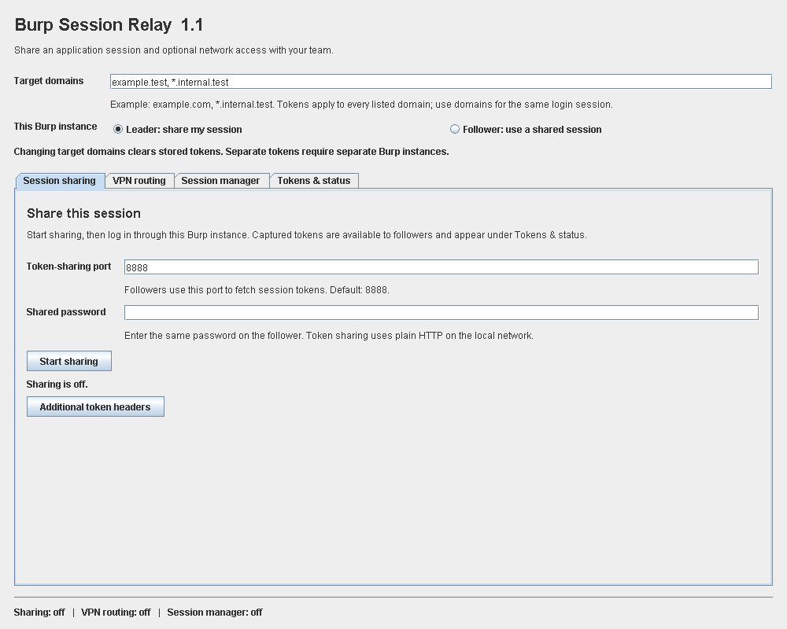
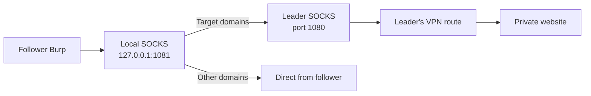

<div align="center">

# Burp Session Relay

**One application session. Your team's Burp instances.**

Share authentication tokens, route selected traffic through a teammate's VPN, and keep a configured session current.

[](https://github.com/worldtreeboy/burp-session-relay/releases/latest)
[](#installation)
[](#development)
[](LICENSE)

[**Download the JAR**](https://github.com/worldtreeboy/burp-session-relay/releases/latest/download/burp-session-relay.jar) · [Quick start](#quick-start) · [VPN routing](#vpn-routing) · [Troubleshooting](#troubleshooting)

</div>

---

Burp Session Relay is a Java extension for teams testing an application with a shared account. One teammate maintains the login as the **leader**; **followers** receive the latest session tokens in their own Burp instances.

If the application is reachable only through the leader's VPN, the optional relay can also carry followers' target traffic through that machine.

## At a glance

| Feature | What it helps you do |
| --- | --- |
| **Session sharing** | Keep cookies, JWTs, CSRF tokens, and selected response headers synchronized across the team. |
| **VPN routing** | Send selected domains through the leader's existing network route while intercepting traffic on the follower. |
| **Session manager** | Use a configured login request to refresh tokens near JWT expiry or after a 401/403. Also works on its own. |
| **Clear session status** | See connection state and stored token types, with token values hidden by default. |

## A simpler interface

Set **Target domains** once at the top, choose **Leader** or **Follower**, then open the tab for the task you need.



| Tab | What you configure |
| --- | --- |
| **Session sharing** | Leader or follower connection details and additional token headers |
| **VPN routing** | The leader's relay or the follower's local SOCKS listener |
| **Session manager** | A login request and automatic refresh settings |
| **Tokens & status** | Current tokens, with an explicit option to reveal their values |

<details>
<summary><strong>Preview the VPN routing tab</strong></summary>


</details>

*Screenshots are rendered from the extension's Swing UI with example data. Appearance follows your Burp theme.*

## Installation

**Requires:** Java 17+ and a Burp Suite version with Montoya API support.

1. Download [**burp-session-relay.jar**](https://github.com/worldtreeboy/burp-session-relay/releases/latest/download/burp-session-relay.jar) from the latest release.
2. In Burp, open **Extensions → Add** and select **Java**.
3. Choose the downloaded JAR. The **Burp Session Relay** tab appears.

**Upgrading?** Reload the extension after replacing the JAR. Version 1.1 removes JWT security findings from Burp's Issues integration. Previously saved findings remain in your project; session-manager JWT expiry checks still work.

## Quick start

### 1. Choose the target domains

Enter the application's domains at the top of the tab, for example:

```text
example.com, *.internal.test
```

Domain entries include their subdomains. All listed domains use **one shared token pool**, so keep unrelated sites and accounts in separate Burp instances. Changing target domains clears stored tokens.

### 2. Start the leader

1. Select **Leader** and open **Session sharing**.
2. Enter a **Shared password** and choose the **Token-sharing port** (default `8888`).
3. If your application needs them, open **Additional token headers** to configure CSRF and other response headers.
4. Click **Start sharing**, then log in to the application through the leader's Burp instance.

Captured tokens appear under **Tokens & status**.

### 3. Connect a follower

1. Select **Follower** and use the same target domains.
2. Enter the leader's reachable hostname or IP address, token-sharing port, and shared password.
3. Click **Connect to leader**.

The status shows when tokens have actually been received. Followers check for updates every **5 seconds** by default and apply them to requests for the configured domains.

> **Need access through the leader's VPN?** Complete the routing setup below as well. The token-sharing connection carries authentication data; website traffic uses a separate SOCKS connection.

## VPN routing

The leader must already be connected to a VPN that can reach the target website. The extension uses the leader's operating system routes and DNS; it does not establish a VPN.



### On the leader

In **VPN routing**, select **Enable VPN relay when sharing starts** and choose a **VPN relay port** (default `1080`). Then click **Start sharing**.

The relay starts and stops with sharing. It uses the same password and target domains. Stop sharing before changing these settings.

### On the follower

1. Enter the leader address and shared password in **Session sharing**.
2. In **VPN routing**, set **Leader VPN relay port** to the leader's relay port.
3. Choose a free **Local SOCKS port** (default `1081`) and click **Start local routing**.
4. In Burp's network settings, configure SOCKS5 with host `127.0.0.1` and the selected local port.
5. Leave authentication empty for this local connection and enable hostname/DNS resolution through SOCKS.

Starting the local listener does not change Burp's network settings or verify website connectivity. The leader's relay port must be reachable, and the VPN must permit the Java process to use its route.

### Which port goes where?

| Setting | Default | Purpose |
| --- | --- | --- |
| Leader token-sharing port | `8888` | Followers fetch session tokens |
| Leader VPN relay port | `1080` | The leader forwards target website traffic |
| Follower local SOCKS port | `1081` | Burp connects to `127.0.0.1` on the follower |

**Phone testing:** point the phone's HTTP/HTTPS proxy at the follower's Burp listener. Interception stays on the follower.

**Stopping routing:** disable or change Burp's SOCKS setting when you stop the local listener, so Burp does not keep sending traffic to a stopped service.

## Session manager

This optional feature works alongside team sharing or on its own.

1. Set the target domains and open **Session manager**.
2. Enter the login URL, HTTP method, content type, request body, and any extra headers.
3. Click **Test login request** to send one request and inspect the token update.
4. Enable **automatic session refresh** when the configuration is ready.

JWT expiry is checked before outgoing requests with a default **30-second buffer**. An in-scope 401/403 triggers a background refresh for subsequent requests. The failed request is not retried, and refresh attempts remain limited to one per five seconds.

The configuration represents one HTTP request. Multi-step login flows, interactive MFA, and redirects may need additional handling outside this extension. Receiving tokens does not by itself prove that a protected request will be authorized.

## Troubleshooting

| What you see | What to check |
| --- | --- |
| Waiting for the first token response | Leader address, token-sharing port, listener state, and local firewall |
| Authentication error | The shared password must match on both instances |
| Tokens arrive, but the private website is unreachable | Enable the separate VPN relay and configure Burp's local SOCKS connection |
| A hostname fails through the relay | Enable DNS through SOCKS and check both instances' target domains |
| Burp loses connectivity after routing stops | Disable or update Burp's SOCKS proxy setting |
| Role or target fields are disabled | Stop active sharing, routing, and session refresh first |

## Security and scope

- **Use a trusted network.** Token sharing uses plain HTTP; the shared secret and SOCKS authentication are not encrypted. These listeners are not designed to be exposed to the public internet.
- **Keep the target list specific.** Token injection and routing share the same scope. Setting `*` applies tokens to every hostname as well as routing every destination.
- **One pool represents one session.** Cookies are stored without browser-style domain/path isolation. Use separate Burp instances for independent sites, accounts, or sessions.
- **Token values are hidden by default.** Reveal them only when you need to inspect them.

Token responses disable caching, token fetches refuse redirects, and the leader relay requires authentication and enforces the configured target scope.

## Development

Build and run the tests on Windows:

```powershell
.\gradlew.bat clean test shadowJar
```

On macOS or Linux:

```bash
./gradlew clean test shadowJar
```

The extension JAR is written to `build/libs/burp-session-relay.jar`.

**v1.1 validation:** 53 tests pass, covering token state, input validation, cookie handling, UI defaults, and local token-sharing/SOCKS forwarding. The routing tests use a loopback HTTP fixture. They do not verify a real VPN, LAN firewall, or a particular site's login behavior.

### What's changed in v1.1

- Reorganized the UI into four focused tabs with shared target settings and clearer status.
- Added input validation and masked token values.
- Fixed stale credentials, scope handling, removed headers, and cookie expiry precedence.
- Hardened token imports, redirect handling, and relay connection cleanup.
- Removed the JWT security findings feature; session-manager expiry checks remain.

## License

[MIT](LICENSE) · Copyright © 2026 worldtreeboy
