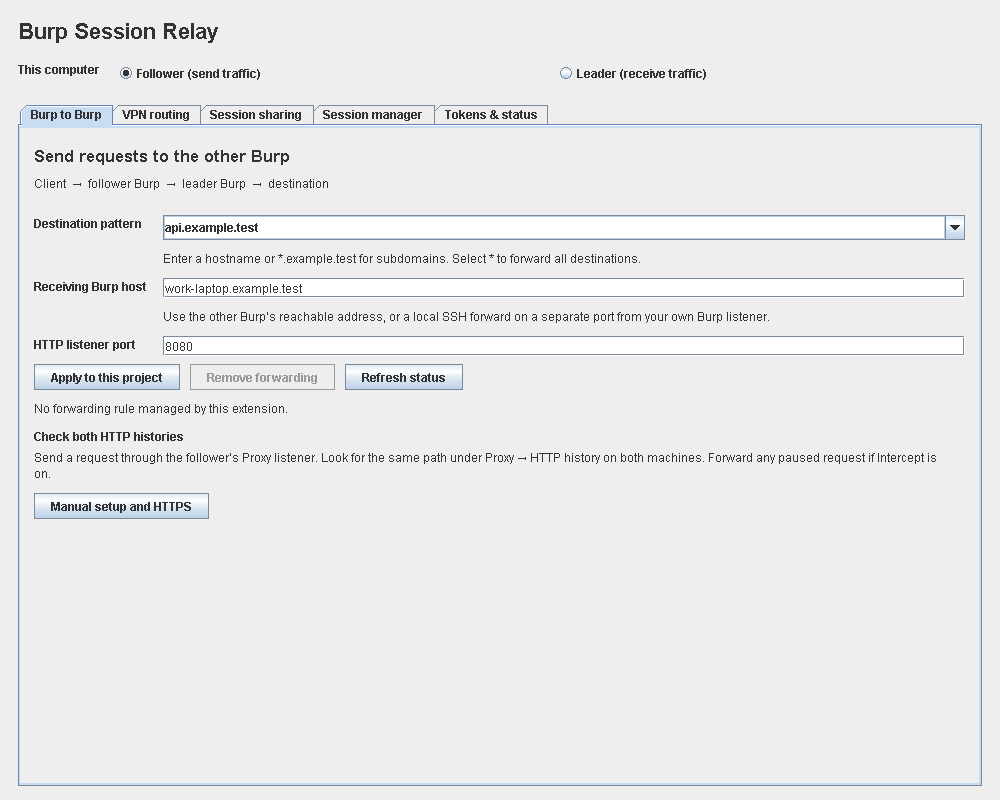
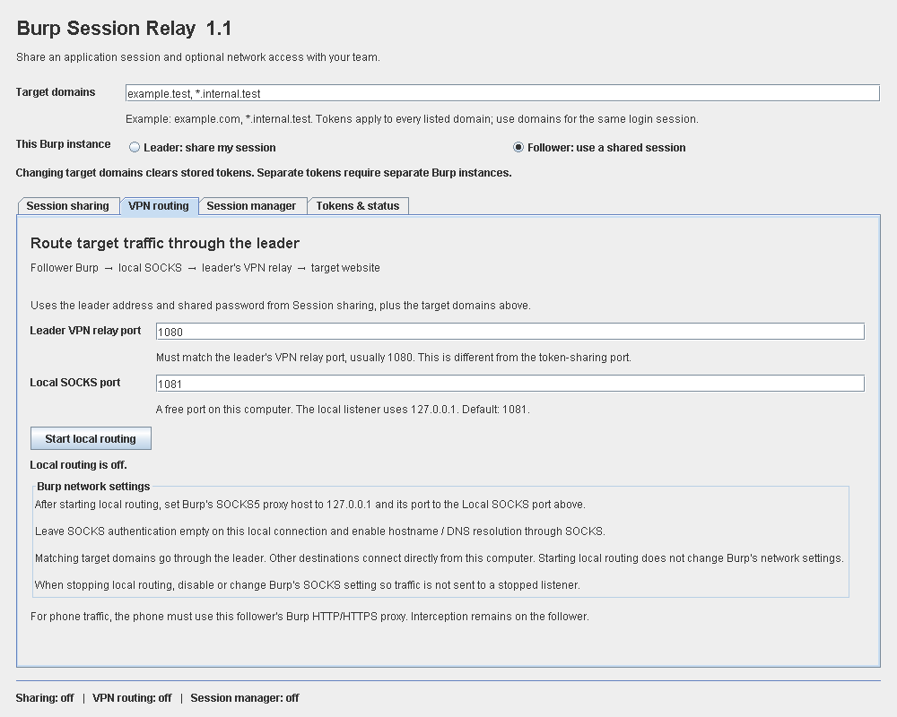

# Burp Session Relay

Forward a domain, matching subdomains, or all outgoing HTTP(S) requests between two Burp instances, route TCP connections through a teammate's VPN, or share a test account's session. Each workflow can be used independently.

## Install

**[Download Burp Session Relay v1.2.1 (JAR)](https://github.com/worldtreeboy/burp-session-relay/releases/download/v1.2.1/burp-session-relay.jar)** · [Release notes](https://github.com/worldtreeboy/burp-session-relay/releases/tag/v1.2.1)

On the sending machine, open **Extensions → Add** in Burp, select **Java**, and choose the downloaded JAR. Reload the extension if replacing an older build. For Burp-to-Burp forwarding, the receiving machine only needs a running Burp HTTP proxy listener. For session sharing or the SOCKS relay, load the same extension build on both machines.

To build from source, use a Java 17 or 21 JDK and run the command for your platform from the repository root. The JAR is written to `build/libs/burp-session-relay.jar`.

| Platform | Build and test |
| --- | --- |
| Windows PowerShell | `.\gradlew.bat test shadowJar` |
| macOS or Linux | `sh ./gradlew test shadowJar` |

## Burp to Burp

Use this path when you want the work laptop's Burp to receive proxied requests and show them in **Proxy → HTTP history**. A browser or mobile app already connected to the first Burp can keep its existing proxy settings.

With session sharing and automatic refresh off, the extension passes the original request to Burp unchanged. The forwarding rule lives in the sending Burp's project settings. It adds no ID, header, or query parameter to the request. Burp itself can reserialize traffic between hops when converting HTTP versions.

```text
Client → this machine's Burp → work laptop's Burp HTTP listener → destination
```

1. **On the work laptop**, open **Settings → Tools → Proxy → Proxy listeners**. Choose a listening address and port reachable from the first machine over a protected connection. The laptop must be able to reach the API. If using SSH port forwarding, the laptop's listener can stay on `127.0.0.1:8080`.
2. **On this machine**, open **Burp to Burp** in the default follower role. Under **Destination pattern**, enter one of the values below. Set **Receiving Burp host** and **HTTP listener port** to the work Burp listener or your local forwarded endpoint, then click **Apply to this project**. Applying again updates the same first-priority upstream rule.

   | Destination pattern | Requests sent to the receiving Burp |
   | --- | --- |
   | `example.com` | That hostname on any path or port |
   | `*.example.com` | Subdomains such as `www.example.com` and `api.example.com` |
   | `*` | All outgoing HTTP(S) destinations handled by this Burp project, including traffic from clients already connected to it |

3. Send one ordinary request to a matching destination. Check its method, path, and status in **Proxy → HTTP history** on both machines. If a request is paused in either instance, forward it or turn interception off for this check. For HTTPS inspection in both histories, the first Burp must accept the work Burp's certificate. If upstream TLS verification is enabled, trust the work Burp CA in the first Burp's server-certificate settings.
4. Click **Remove forwarding** when you want to stop. Unloading the extension on its own leaves the saved upstream rule active. You can also manage it under **Settings → Network → Connections → Upstream proxy servers**. If you previously used VPN routing, check Burp's SOCKS setting, which also applies to upstream proxy connections.



For example, with authorized SSH access to the work laptop, this command on the first machine forwards its port `18080` to the work Burp's loopback listener. Set the upstream rule to `127.0.0.1:18080`. Using a separate local port keeps the app's existing `8080` listener available.

```sh
ssh -N -L 127.0.0.1:18080:127.0.0.1:8080 user@work-laptop
```

Burp uses the first matching upstream rule. Other project rules remain below the forwarding rule. If the project inherits upstream rules containing authentication, use **Manual setup and HTTPS → Open Burp settings** to configure forwarding directly. This keeps inherited credentials in user settings. The destination pattern is independent of session-sharing target domains. [PortSwigger connection settings](https://portswigger.net/burp/documentation/desktop/settings/network/connections)

## VPN routing

Choose **VPN routing** when the work laptop should open connections directly to the API using its operating system routes and DNS. Interception stays in the follower's Burp. The leader needs working access to the API through its VPN.

| Port by default | Service |
| --- | --- |
| `1080` | Leader's authenticated SOCKS relay |
| `1081` | Follower's local SOCKS listener on `127.0.0.1` |
| `8888` | Optional leader token-sharing service |

1. On the leader, enter the **Target domains**, choose **VPN routing**, set a **Relay password**, and click **Start relay**. This starts routing independently of session sharing.
2. The leader listens on loopback by default. Use an encrypted port forward to the leader or select **Allow connections from other devices** for direct access over a protected network. That option binds the service on all interfaces. SOCKS authentication and the token-sharing protocol have no built-in transport encryption.
3. On the follower's **VPN routing** tab, enter the same target domains, the leader address or forwarded endpoint, the relay port and the relay password. Choose an available **Local SOCKS port** and click **Start local routing**.
4. In the follower's Burp, select **Settings → Network → Connections → Use SOCKS proxy**. Set the proxy to `127.0.0.1:1081` (or your local port), leave local authentication empty and enable **Do DNS lookups over SOCKS proxy**. A successful listener start means that the local port is ready. Send an in-scope request to verify the full route.
5. Disable Burp's SOCKS setting when stopping the local listener.

Matching hostnames go through the leader. Unlisted hostnames go directly from the follower. Unlisted IP addresses are blocked by default because the original hostname may have been resolved before reaching the relay. **Allow direct connections to unlisted IP addresses** opts into direct IP routing. The relay supports TCP. UDP and QUIC require a different transport.



## Session sharing

Use named targets belonging to the same application session, such as `app.example.test, api.example.test`. Domain entries include subdomains. The standalone `*` is reserved for routing. Non-cookie credentials such as bearer tokens and configured headers are shared across the agreed target list.

1. On the leader's **Session sharing** tab, set the token-sharing port and **Token password**. Use a different password from the relay. Under **Additional token headers**, configure any CSRF or custom response header names your application needs. Click **Start sharing** and log in through the leader's Burp.
2. On the follower, set the same target list. Enter the leader's address, token-sharing port and token password under **Session sharing**. Click **Connect to leader**. The follower polls every five seconds by default.
3. Check **Tokens & status** for captured token types. Values are masked by default. A successful fetch can contain an empty session if the leader has not logged in yet.

Cookies retain their host/domain, path, Secure flag and expiry. Older snapshots without the information needed for safe replay are refused. A mismatched target list prevents token import. Keep the transport between teammates encrypted, including when using separate relay and token passwords.


## Session manager

Set named target domains and open **Session manager**. Configure the login URL, method, content type, body and extra headers. **Test login request** sends one real request and updates the token store. Enable automatic refresh after verifying the result.

The manager checks JWT expiry with a default 30-second buffer. An in-scope 401 or 403 can trigger a background login to refresh subsequent requests. The original request is returned to its caller. This feature supports single-request logins and can run independently of team sharing.

## Troubleshooting

| Symptom | Check |
| --- | --- |
| Only the first Burp sees the API call | Check the upstream destination hostname and rule order, the work Burp's HTTP listener port, and whether either instance is paused at Intercept. A successful SOCKS relay alone sends traffic straight from the leader to the API. |
| The work Burp sees a request but the API fails | Check the work laptop's API DNS, VPN route, TLS trust and upstream rules. Avoid pointing the work Burp back at the first Burp. |
| SOCKS rejects an unlisted IP | Enable DNS through SOCKS or explicitly include the intended numeric target. |
| The follower cannot connect to the leader | Check the service's bind address, encrypted connection or port forward, listener port and corresponding password. |
| Token sync reports incompatible targets or format | Use the current build on both instances and configure the same target domains before reconnecting. |
| Burp loses connectivity after stopping local routing | Disable the SOCKS setting or point it to a running listener. |

## Development

The Gradle test suite covers token state, cookie handling, UI controls, and forwarding over real loopback sockets. Run `test shadowJar` to test and build the Java extension. The output is `build/libs/burp-session-relay.jar`.

[MIT license](LICENSE)
