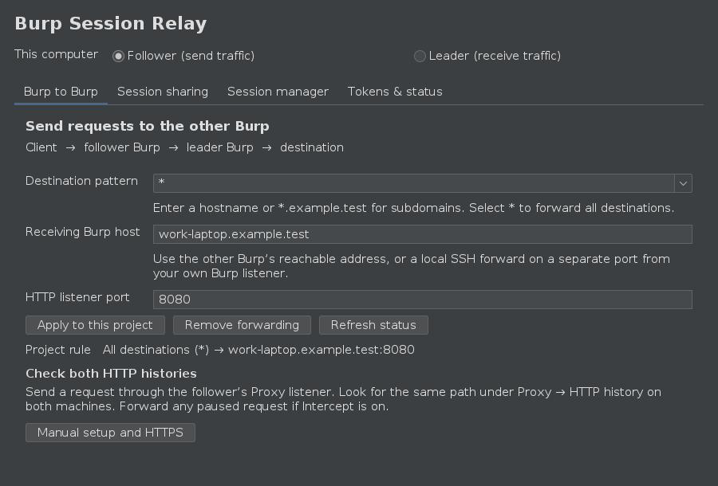
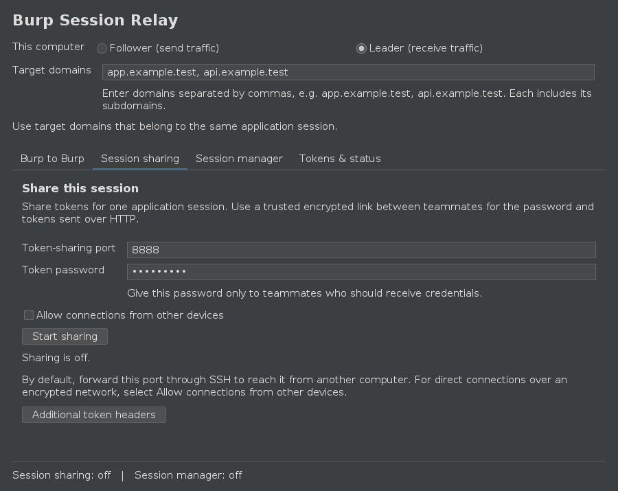

# Burp Session Relay

Forward one hostname, matching subdomains, or all outgoing HTTP(S) requests from one Burp instance to another. Optionally, share a test account’s session or refresh it automatically.

## Install

**[Download Burp Session Relay v1.2 (JAR)](https://github.com/worldtreeboy/burp-session-relay/releases/download/v1.2/burp-session-relay.jar)** · [Release notes](https://github.com/worldtreeboy/burp-session-relay/releases/tag/v1.2)

On the sending machine, open **Extensions → Add** in Burp, select **Java**, and choose the downloaded JAR. Reload the extension if replacing an older build. For forwarding, only the sending machine needs the extension. The receiving machine needs a running Burp HTTP proxy listener. To share session tokens, load the same extension build on both machines.

To build from source, use a Java 17 or 21 JDK and run the command for your platform from the repository root. The JAR is written to `build/libs/burp-session-relay.jar`.

| Platform | Build and test |
| --- | --- |
| Windows PowerShell | `.\gradlew.bat test shadowJar` |
| macOS or Linux | `sh ./gradlew test shadowJar` |

## Burp to Burp

Use this path when you want the work laptop's Burp to receive proxied requests and show them in **Proxy → HTTP history**. A browser or mobile app already connected to the first Burp can keep its existing proxy settings.

With session sharing and automatic refresh off, the extension passes the original request to Burp unchanged. The forwarding rule lives in the sending Burp's project settings. It adds no ID, header, or query parameter to the request. Burp itself can reserialize traffic between hops when converting HTTP versions.

```text
Client → this machine's Burp → work laptop's Burp HTTP listener → destination
```



1. **On the work laptop**, open **Settings → Tools → Proxy → Proxy listeners**. Choose a listening address and port reachable from the first machine over a protected connection. The receiving Burp connects to the destination using the laptop’s network routes and DNS, including its VPN when connected. If using SSH port forwarding, the laptop's listener can stay on `127.0.0.1:8080`.
2. **On this machine**, open **Burp to Burp** in the default follower role. Under **Destination pattern**, enter one of the values below. Set **Receiving Burp host** and **HTTP listener port** to the work Burp listener or your local forwarded endpoint, then click **Apply to this project**. Applying again updates the same first-priority upstream rule.

   | Destination pattern | Requests sent to the receiving Burp |
   | --- | --- |
   | `example.com` | That hostname on any path or port |
   | `*.example.com` | Subdomains such as `www.example.com` and `api.example.com` |
   | `*` | All outgoing HTTP(S) destinations handled by this Burp project, including traffic from clients already connected to it |

3. Send one ordinary request to a matching destination. Check its method, path, and status in **Proxy → HTTP history** on both machines. If a request is paused in either instance, forward it or turn interception off for this check. For HTTPS inspection in both histories, the first Burp must accept the work Burp's certificate. If upstream TLS verification is enabled, trust the work Burp CA in the first Burp's server-certificate settings.
4. Click **Remove forwarding** when you want to stop. Unloading the extension on its own leaves the saved upstream rule active. You can also manage it under **Settings → Network → Connections → Upstream proxy servers**.

For example, with authorized SSH access to the work laptop, this command on the first machine forwards its port `18080` to the work Burp's loopback listener. Set the upstream rule to `127.0.0.1:18080`. Using a separate local port keeps the app's existing `8080` listener available.

```sh
ssh -N -L 127.0.0.1:18080:127.0.0.1:8080 user@work-laptop
```

Burp uses the first matching upstream rule. Other project rules remain below the forwarding rule. If the project inherits upstream rules containing authentication, use **Manual setup and HTTPS → Open Burp settings** to configure forwarding directly. This keeps inherited credentials in user settings. The destination pattern is independent of session-sharing target domains. [PortSwigger connection settings](https://portswigger.net/burp/documentation/desktop/settings/network/connections)

**Upgrading from the old VPN routing tab?** If the sending Burp’s **Use SOCKS proxy** setting still points to the extension’s retired local listener (formerly `127.0.0.1:1081` by default), disable that setting. Keep any separately managed proxy your network requires. The sender still needs a working network path or port forward to the receiving Burp listener.

## Session sharing

Use named targets belonging to the same application session, such as `app.example.test, api.example.test`. Domain entries include subdomains. The standalone `*` is available for Burp-to-Burp forwarding. Session sharing requires named targets. Non-cookie credentials such as bearer tokens and configured headers are shared across the agreed target list.

1. On the leader's **Session sharing** tab, set the token-sharing port (default `8888`) and **Token password**. Under **Additional token headers**, configure any CSRF or custom response header names your application needs. Click **Start sharing** and log in through the leader's Burp.
2. On the follower, set the same target list. Enter the leader's address, token-sharing port and token password under **Session sharing**. Click **Connect to leader**. The follower polls every five seconds by default.
3. Check **Tokens & status** for captured token types. Values are masked by default. A successful fetch can contain an empty session if the leader has not logged in yet.

Cookies retain their host/domain, path, Secure flag and expiry. Older snapshots without the information needed for safe replay are refused. A mismatched target list prevents token import. The leader’s token service listens on loopback by default. Its plain HTTP protocol carries the follower’s password and the leader’s session tokens. Use an encrypted port forward, or select **Allow connections from other devices** to listen on all interfaces when both machines communicate over a protected network.



## Session manager

Set named target domains and open **Session manager**. Configure the login URL, method, content type, body and extra headers. **Test login request** sends one real request and updates the token store. Enable automatic refresh after verifying the result.

The manager checks JWT expiry with a default 30-second buffer. An in-scope 401 or 403 can trigger a background login to refresh subsequent requests. The original request is returned to its caller. This feature supports single-request logins and can run independently of team sharing.

## Troubleshooting

| Symptom | Check |
| --- | --- |
| Only the sending Burp shows the request | Check the destination pattern, upstream rule order and receiving listener address and port. Confirm the sender can reach that listener and that neither instance has paused the request at Intercept. |
| The receiving Burp shows the request but cannot reach the destination | Check that machine’s DNS, VPN route, TLS trust and upstream rules. Pointing its upstream rule back at the sender creates a loop. |
| The follower cannot fetch session tokens | Check the leader’s token-sharing port, bind address, encrypted connection or port forward, and token password. |
| Token sync reports incompatible targets or format | Use the current build on both instances and configure the same target domains before reconnecting. |

## Development

The Gradle test suite covers upstream rule changes, forwarding-only request handling, UI controls, cookie handling and token sharing over loopback. Run `test shadowJar` to test and build the Java extension. The output is `build/libs/burp-session-relay.jar`.

[MIT license](LICENSE)
